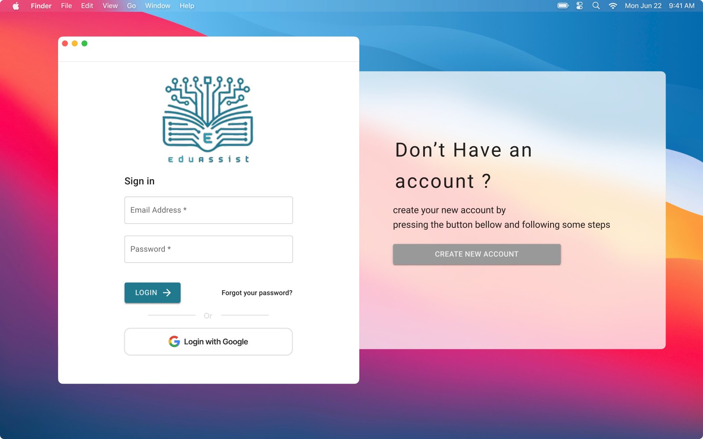
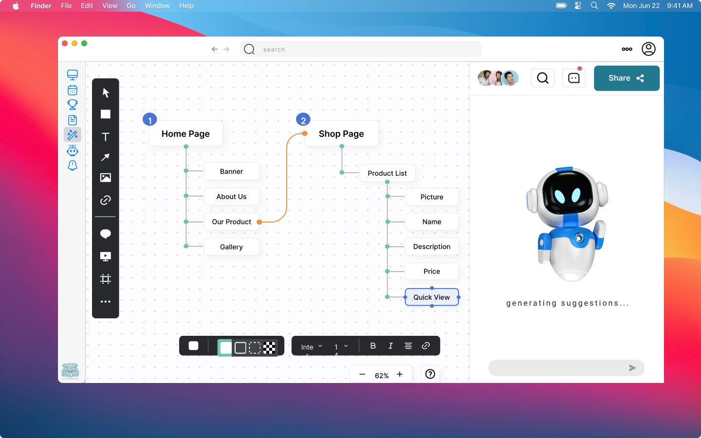
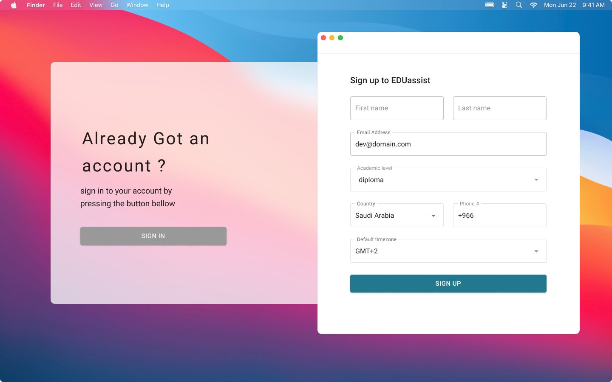
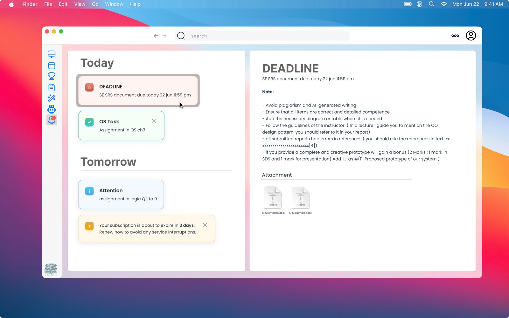
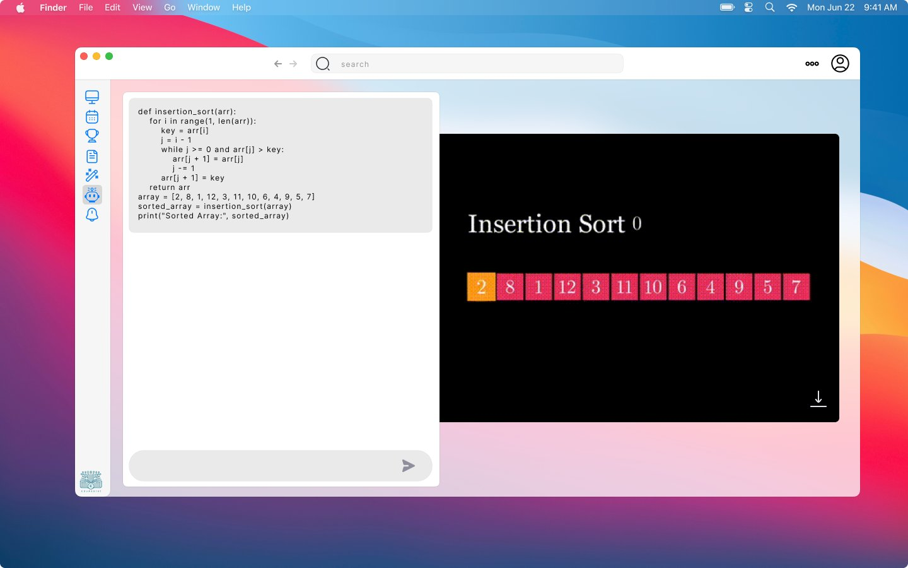
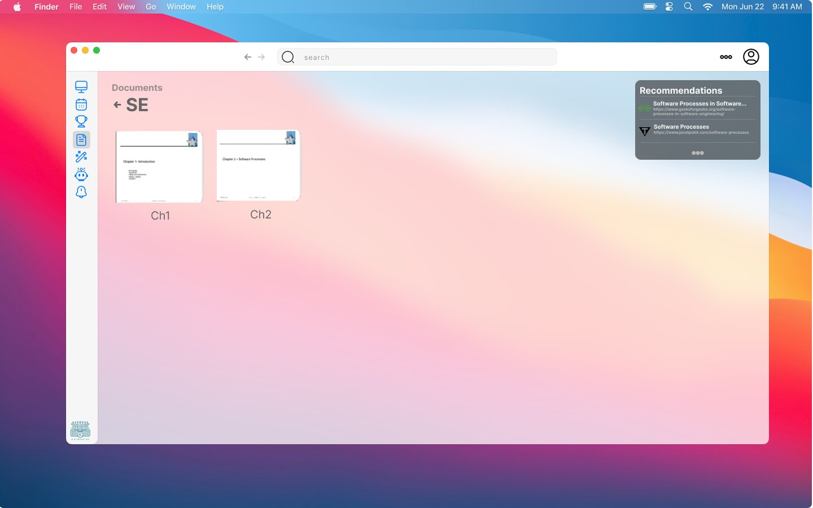
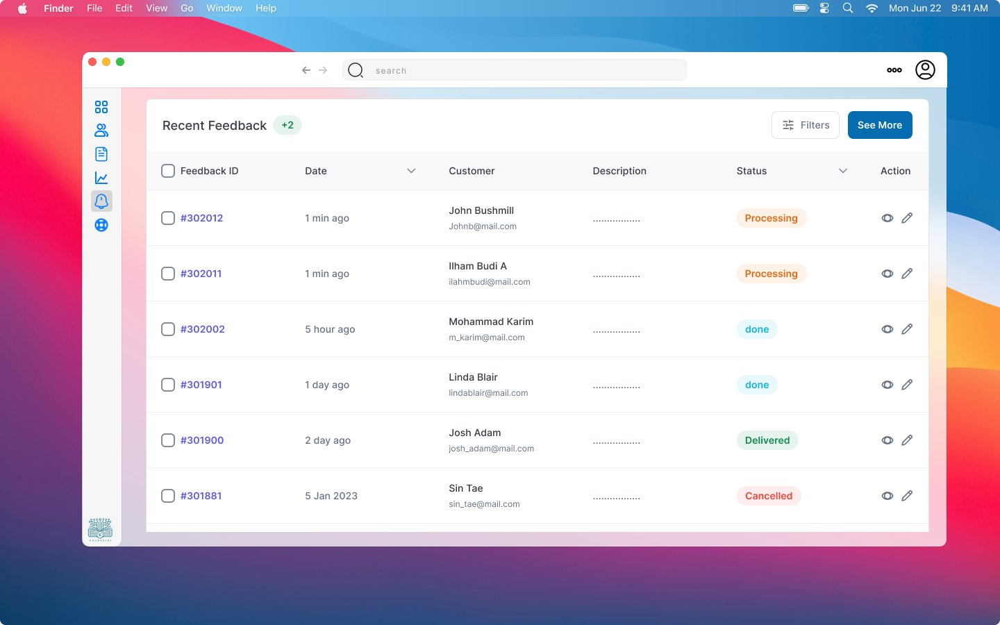
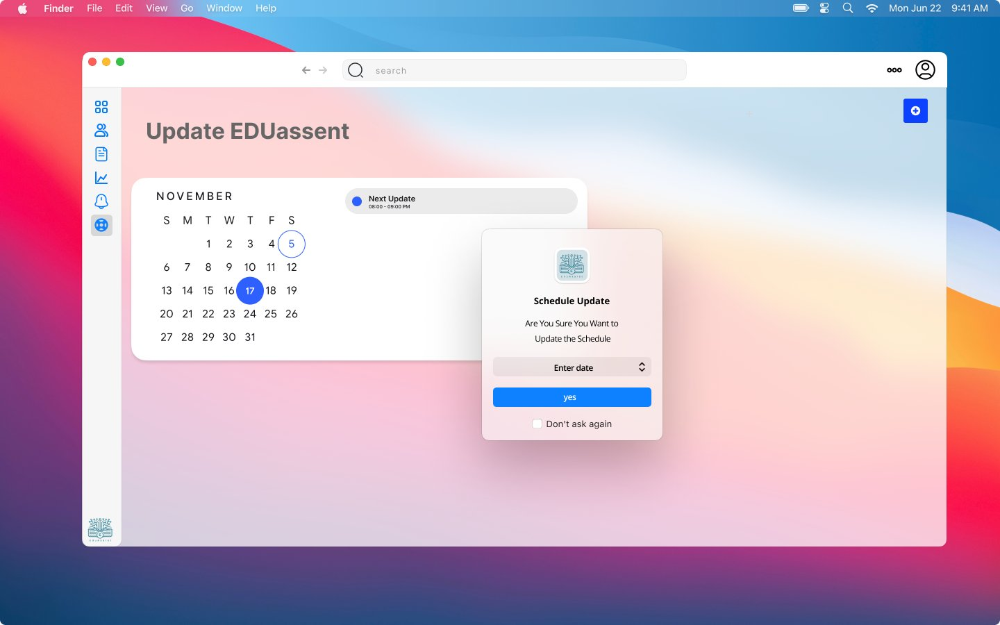

# 🎓 EDUassist: AI-Powered Academic Assistant

**An AI assistant that organizes students' academic life:** it turns syllabi into weekly study plans, offers a collaborative AI whiteboard, converts lecture text into animated visual lessons, and recommends study resources.

> Software Engineering (**CS 411**) team project, Imam Abdulrahman Bin Faisal University (IAU), 2024.
> The project followed the full software lifecycle: **Proposal → SPMP → SRS → SDS → STP**, with a high-fidelity UI prototype and a database design.

<p align="center">
  
  
</p>

---

## ❗ The problem

Students struggle to manage their academic responsibilities. Traditional study planning isn't flexible or personalized, their academic tools don't work together, and there are few interactive, visual learning aids. This all leads to weaker understanding and engagement.

## ✨ Features

| Feature | Description |
|---|---|
| 📅 **Study plan organization** | Reads the syllabus from a PDF and turns it into a weekly study schedule |
| 🔗 **App integration** | Syncs academic tasks with **Google Calendar** |
| 🧠 **Collaborative AI whiteboard** | Shared whiteboard for brainstorming and mind maps, with AI that suggests ideas and corrects errors |
| 🎬 **Visual learning (VisuText)** | Converts lecture text into animated visual content to aid understanding |
| 📚 **Resource recommendations** | AI suggests videos, articles and books based on the student's needs |
| 👥 **Peer collaboration** | Study with classmates through the shared whiteboard and video calls |
| 🔔 **Notifications & deadlines** | Today/tomorrow task view, deadline details and reminders |
| 🛠️ **Admin panel** | Manage feedback and alerts, configure system updates and generate reports |

## 📱 UI prototype

| | |
|---|---|
|  |  |
| Sign up | Notifications & deadlines |
|  |  |
| VisuText: lecture to animation | Resource recommendations |
|  |  |
| Admin: feedback & alerts | Admin: system update scheduling |

All screens are in [`docs/ui/`](docs/ui), including sign-in with validation errors, the forgot-password flow, Google login, profile and settings.

## 📄 Software engineering documents

| # | Document | What it covers |
|---|---|---|
| 1 | [Project Proposal](docs/01-project-proposal.pdf) | Idea, problem statement, objectives, end users |
| 2 | [SPMP](docs/02-spmp-project-management-plan.pdf) | Software Project Management Plan: organization, schedule, risk and change control |
| 3 | [Status Report 1](docs/03-status-report-1.pdf) | Progress after the planning phase |
| 4 | [SRS](docs/04-srs-requirements-specification.pdf) | Software Requirements Specification: functional and non-functional requirements, use cases, analysis models |
| 5 | [SDS](docs/05-sds-design-specification.pdf) | Software Design Specification: architecture, detailed design, data design, UI |
| 6 | [Status Report 2](docs/06-status-report-2.pdf) | Progress after the design phase |
| 7 | [STP](docs/07-stp-test-plan.pdf) | Software Test Plan: test strategy, test cases and approvals |

## 🗄️ Database

[`database/schema.sql`](database/schema.sql) creates the 10 tables: `User`, `Admin`, `StudyPlan`, `Task`, `Notification`, `Progress`, `Resource`, `Whiteboard`, `Video` and `Recommendation`.

```bash
mysql -u root -p -e "CREATE DATABASE eduassist"
mysql -u root -p eduassist < database/schema.sql
```

## 📁 Repository structure

```
.
├── docs/
│   ├── 01-project-proposal.pdf … 07-stp-test-plan.pdf   # Lifecycle documents
│   └── ui/                                               # UI prototype screens
├── database/
│   └── schema.sql
└── README.md
```

---

<details>
<summary>🇸🇦 ملخص بالعربي</summary>

**EDUassist** مساعد أكاديمي ذكي يساعد الطلاب ينظمون دراستهم:
- يحوّل خطة المادة (Syllabus) لجدول مذاكرة أسبوعي، ويربطه مع Google Calendar.
- سبورة ذكية مشتركة للعصف الذهني والخرائط الذهنية.
- يحوّل نص المحاضرة لمحتوى مرئي متحرك.
- يقترح مصادر مذاكرة تناسب احتياج الطالب.

مشروع مادة هندسة البرمجيات (CS 411)، ومرّ بكل مراحل دورة حياة البرمجيات: المقترح، وخطة إدارة المشروع، والمتطلبات، والتصميم، وخطة الاختبار.
</details>
